# Card Reveal Studio v0.18.0

Premiere Pro 2026（26.x）・Windows向けの編集支援パネルです。カードめくり・台形3分割・4分割スライド・画像の外周強調を作成し、編集済みの素材として保存できます。DiscordをイメージしたUIで、プラグイン・動画・画像を切り替えます。

## ダウンロードと更新

1. [更新用ZIPをダウンロード](https://github.com/SuGiYaMaKaZuK/-/raw/refs/heads/main/CardReveal-v0.18.0.zip)します。
2. Premiereを終了し、ZIPを右クリックして **すべて展開** します。
3. 展開した **Install.cmd** を実行します。管理者権限は不要です。
4. 初回は描画用FFmpegを取得します。Premiereを起動し、**ウィンドウ → エクステンション → Card Reveal カード演出** を開きます。
5. 左端のプラグインアイコンにマウスを置くと、バージョン **v0.18.0** を確認できます。

更新後も保存済みの演出と素材・配置を引き継ぎます。GitHubのCode → Download ZIPから取得した場合は、インストール時にサンプル画像を復元します。

## 4つの素材を上から登場させる

1. **プラグイン → # 元素材 → 4分割スライド** を開き、4つの **＋** に画像や動画を1つずつドロップします。＋をクリックしても選べます。
2. **設定 → 配置** で **横4列** または **田の字（2×2）** を選びます。横4列は左から順に、田の字は左上・右上・左下・右下の順に降りてきます。
3. **登場の間隔** を **0秒** にすると4つが同時に降ります。各素材の大きさ・X/Y、降りてくる時間、境界線の太さと色も調整できます。
4. **▶** で動きを確認し、**書き出し** で映像を作成します。次回も使う設定は **保存** でグループに登録します。

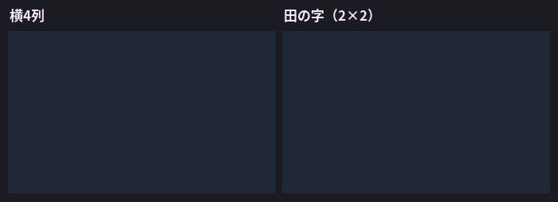

## 透過素材に縁取りを付ける

「プラグイン」→「# 元素材」→「画像を強調」で、背景を透過した画像や動画を入れます。「外周の形と位置」の **透過素材の輪郭に沿う** は初期状態でオンです。保存済みの外周強調を開いたときも使えます。

新しい演出では、輪郭に沿った幅2 pxの明るい線の外側に、金色の光がふわっと広がります。髪や服の色を保ち、半透明の毛先では光も薄くなります。離れたパーツや内側の穴にも縁が付き、透過動画では被写体の動きに追従します。

保存済みの演出は **設定 → 外周の枠を重ねる → 光る縁取り** で切り替えます。素材と配置を保ったまま枠のレイヤーを置き換えます。選択された **外側の光** の **不透明度** で光の強さを、**光の広がり** で届く範囲を調整できます。前の設定に戻すには **↶ 戻す** を押します。タイムラインに反映するにはもう一度書き出します。

線の色や太さ、光の広がりはレイヤーごとに調整できます。素材を四角・角丸・多角形で囲むときは **透過素材の輪郭に沿う** をオフにします。

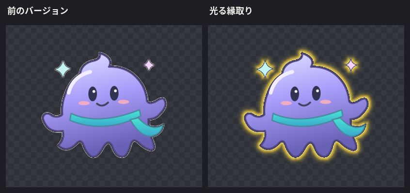

## 軽量版の変更

プレビューは再生中だけ定期更新します。素材と配置の一覧は、開いた画面に必要なサムネイルを読み込みます。素材検索では、グループごとの素材一覧を再利用します。

元の画像・動画を参照して、これまでと同じ解像度・フレームレート・ProRes 4444設定で書き出します。更新用ZIPにはパネルとサンプル画像、インストーラー、使い方を収録しています。

## 左端は3つのアイコン

- **プラグイン：** 中に **# 元素材** と **# 作成済みの素材** があります。
- **動画：** 動画を自分で付けた名前のグループに分けます。
- **画像：** 画像も独立したグループに分けます。

「すべての保存」とテロップの登録・保存・挿入は画面と起動処理から外しました。以前のテロップ登録データは互換性のため保持し、保管ファイルや挿入済みのクリップを削除しません。

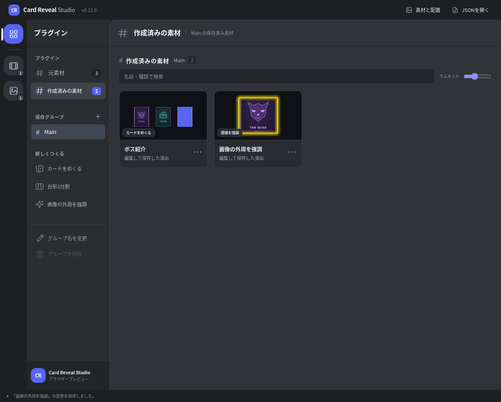

## プラグインを作る・保存する

**# 元素材** から、カードめくり・台形3分割・4分割スライド・外周強調のいずれかを選びます。画像・動画、位置・大きさ・X/Y、演出の動きなどを編集し、**グループに保存** で名前を付けます。

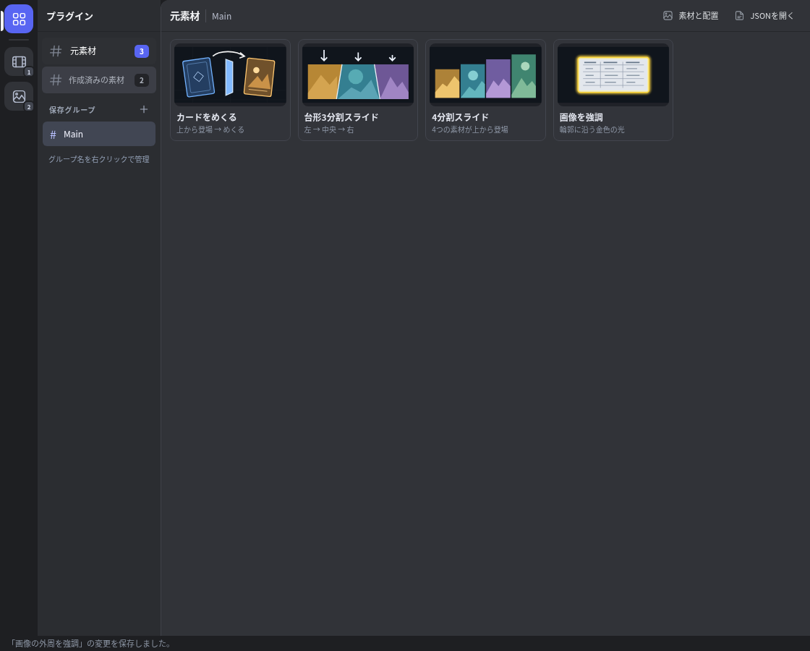

**# 作成済みの素材** では、保存グループごとの演出をサムネイルから開けます。変更を保存する操作と別名保存を使い分けられます。保存グループは＋で追加できます。グループ名を右クリックして **名前を変更** または **削除** を選び、取り消すときは **×** を押します。削除したグループの演出は、残っている保存先へ移動します。

エクスプローラーから、使いたいカードの **＋** に画像または動画を1つドロップします。設定済みの枠に落とすとそのカードを差し替えます。クリックでファイルを選ぶこともできます。

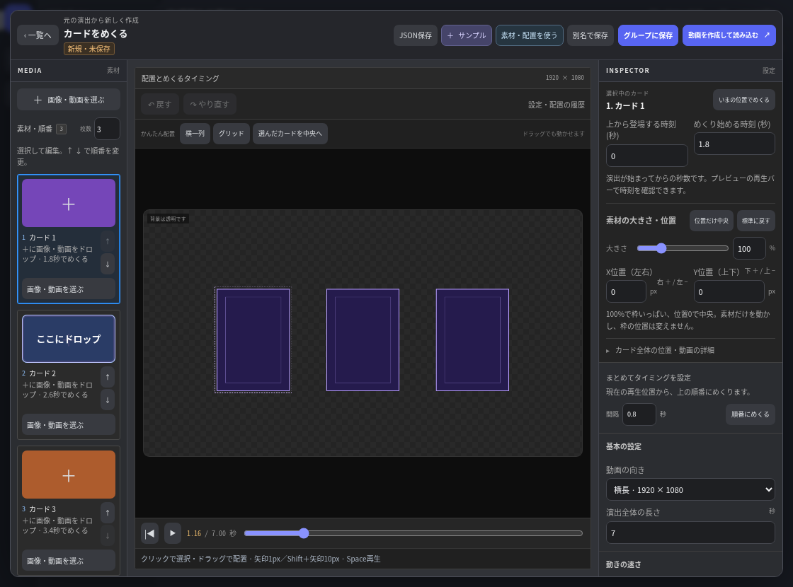

カードは1〜12枚で、上から登場し、好きな位置・順番・時刻でめくれます。台形3分割では3素材、4分割スライドでは4素材を上から登場させます。外周強調は素材の縦横比から枠を合わせ、形・色・発光・レイヤーを調整できます。

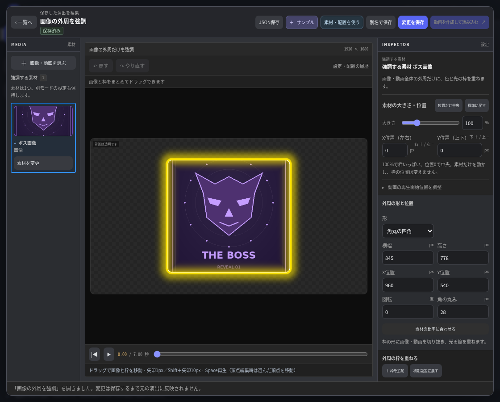

## 画像・動画をグループに分ける

既存の画像・動画は最初は **# 未分類** に表示します。画像と動画は別々のグループを持ち、同じ名前を付けても混ざりません。

1. 左端の画像または動画のアイコンを押します。
2. 左メニューのグループ見出し横にある **＋** を押し、名前を付けます。例：サムネイル、説明画像、オープニング、ゲーム収録。
3. エクスプローラーから一覧へファイルをドロップします。複数の画像・動画を一緒に登録でき、種類ごとに最後に選んだグループに入ります。
4. 登録後は素材の **⋯ → 移動先 → 移動** でも整理できます。
5. 次回起動後も、グループ名・振り分け・選択を保持します。

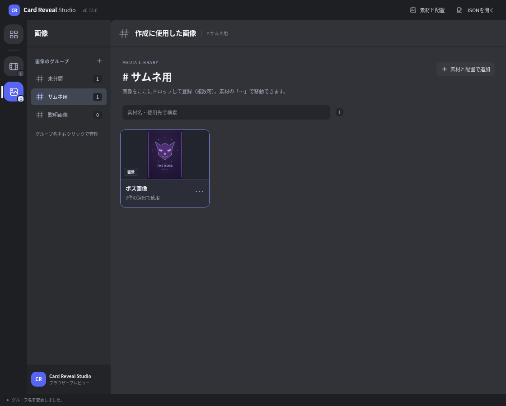

グループ名の先頭に#を入力しても、名前だけを保存します。グループ名の右クリックまたは **Shift＋F10** で管理メニューが開きます。名前の入力後も、削除の確定前も、右上の **×** で取り消せます。削除時は素材を残っているグループへ移し、元のファイルや演出の設定を変更しません。最後のグループは削除できません。

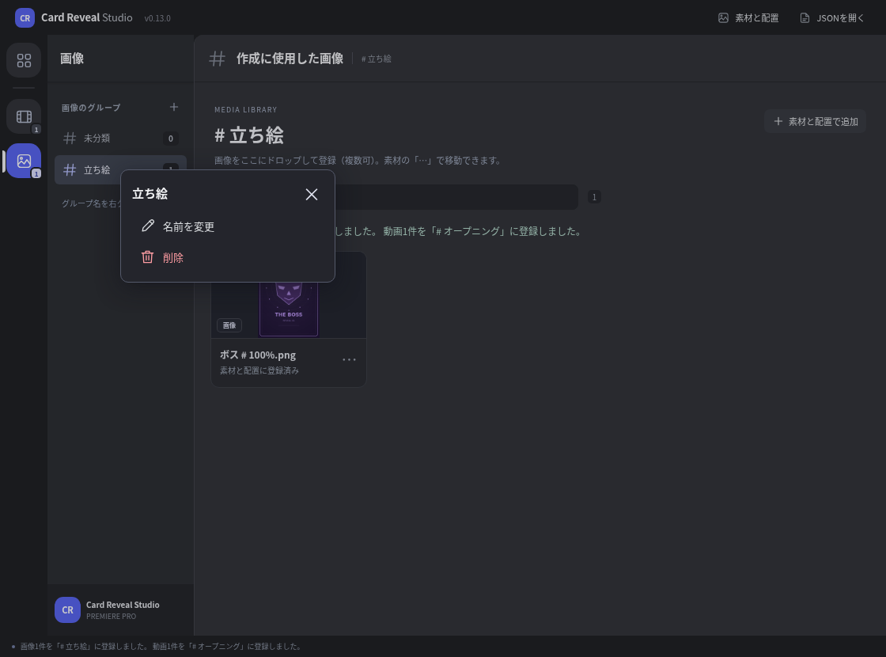

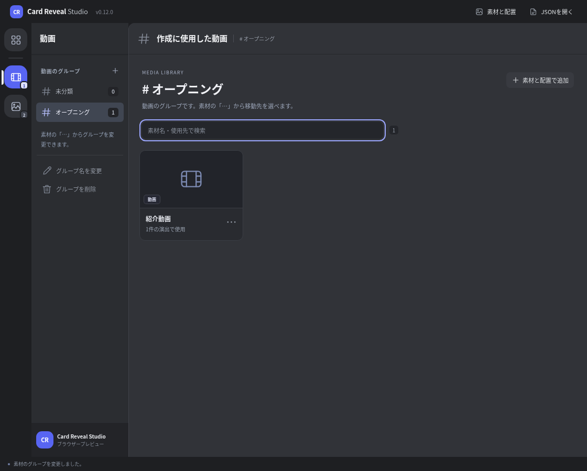

一覧は「素材と配置」に登録した素材と、保存した演出で使った素材をまとめたものです。同じ場所の同じ種類の素材は重複をまとめ、使用先を表示します。PC全体のファイル検索は行いません。

画像・動画一覧の **＋ 追加** から配置を指定して素材を登録できます。ドロップでの一括登録も使えます。同じファイルをもう一度ドロップすると選んだグループに入り、登録済みの大きさとX/Yを引き継ぎます。グループ分けは素材の参照を整理する機能で、ファイルを移動・複製しません。

## プレビュー・素材と配置

画像・動画をクリックすると、元の素材・使用先・ファイルの場所を確認できます。動画は自動再生せず、最初はミュートです。閉じると再生を停止します。対応形式はパネルの再生機能に依存し、表示できない場合は案内を出します。

上部の **素材と配置** は、以前のSABUを引き継ぐ素材管理です。新規登録・編集画面のプレビューに1つドロップすると、名前・大きさ・X/Yを設定してから保存できます。画像・動画と大きさ・X/Yを保存し、別の演出へ適用できます。演出の動きや枠の設定はここには含めません。

素材を削除・移動した場合は、参照先を選び直してください。素材と配置から登録を削除しても、元の画像・動画ファイルは消しません。

## 狭いパネル・キーボード

パネルの最小サイズは320 × 360 pxです。ライブラリの幅が760px以下になると、プラグインの「元素材」「作成済みの素材」が上部に並びます。グループを選ぶには、左上の **# グループ名 ▾** を押します。

編集画面の幅が880px以下では、**素材** で画像・動画を入れ、**プレビュー** で配置と再生を確認し、**設定** で大きさ・X/Yやタイミングを調整できます。上部に **保存** と **書き出し** があり、**⋯** から素材と配置の読み込み、別名保存、JSON保存、サンプルを開けます。

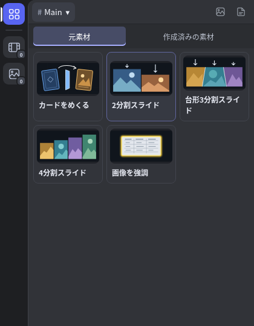
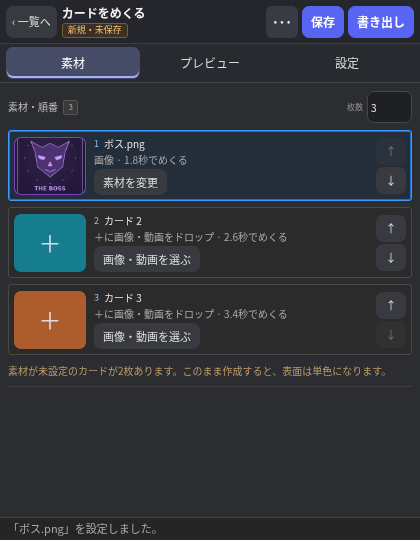

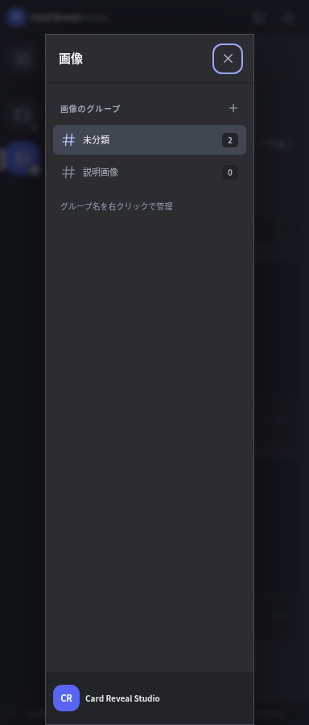

- **Ctrl＋F：** 表示中の素材の検索。
- **グループ一覧の↑↓・←→・Home・End：** グループの切り替え。
- **編集画面のCtrl＋S／Ctrl＋Shift＋S：** 保存／別名保存。
- **Ctrl＋Z／Ctrl＋Shift＋Z・Ctrl＋Y：** 演出編集の取り消し・やり直し。
- **プレビューの矢印／Shift＋矢印：** 1px／10px移動。Spaceは再生・一時停止です。

入力中の文字の取り消しは通常の入力操作を優先します。画像・動画のグループ変更は、演出編集のUndo対象には含みません。

## Premiereで使う

**動画を作成して読み込む** で無音のProRes 4444 MOVを生成し、Premiereのプロジェクトに読み込みます。タイムラインへの配置はPremiereで行ってください。透過背景・単色背景、24・25・30・60・90・120fpsに対応します。設定を変える場合はパネルで編集して再書き出しします。

グループ・保存済み演出・素材と配置・画像動画の振り分けは、同じPCのパネル内に保存します。JSON保存／JSONを開くは演出1件の設定用で、ライブラリや素材グループ全体のバックアップではありません。

## 開発・確認状況

`npm test` でモデル・ファイル処理・互換性・素材グループを確認します。PlaywrightとChromiumを用意して `node tests/ui-smoke.cjs`、`node tests/editing-ui-smoke.cjs`、`node tests/channels-ui-smoke.cjs`、`node tests/file-drop-ui-smoke.cjs`、`node tests/compact-layout-ui-smoke.cjs`、`node tests/performance-ui-smoke.cjs`、`node tests/alpha-outline-ui-smoke.cjs` と `node tests/quad-ui-smoke.cjs` を実行できます。動画確認にはFFmpeg・ffprobeを使用します。パネル利用時にnpmの導入は不要です。

画面写真はサンプル素材を使い、実際のパネルを操作して撮影したものです。Premiereの通信は模擬しています。**WindowsのインストーラーとPremiere Pro 2026実機での連携は未検証です。** [検証結果を見る](https://github.com/SuGiYaMaKaZuK/-/blob/main/検証結果.txt)

導入先は `%APPDATA%\Adobe\CEP\extensions\com.cardreveal.panel` です。ローカル開発版を表示するため、インストーラーはHKCUのCSXS.12 PlayerDebugModeを1にします。FFmpegは固定リリースから取得し、SHA-256を照合します。削除にはuninstall-windows.ps1を使います。
