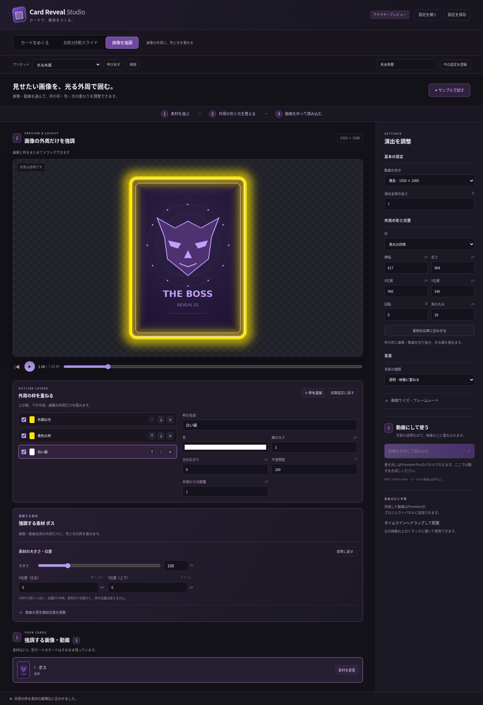

# Card Reveal カード演出 v0.4.0

Premiere Pro 2026（26.x）・Windows向けの開発版です。カードめくり・台形3分割スライド・画像の外周強調を作成できます。

## ダウンロードと導入

1. [導入用ZIPをダウンロード](https://github.com/SuGiYaMaKaZuK/-/raw/refs/heads/main/CardReveal-v0.4.0.zip)します。ページの緑色の **Code → Download ZIP** からも取得できます。
2. ダウンロードしたZIPを右クリックして **すべて展開** します。
3. **Premiere Proを終了**します。
4. 展開したフォルダー内の **Install.cmd** をダブルクリックします。管理者権限は不要です。
5. 初回は描画用FFmpegを取得します（約30MB）。完了まで待ちます。
6. Premiereを起動し、**ウィンドウ → エクステンション → Card Reveal カード演出** を開きます。
7. **サンプルで試す** を押して動きを確認します。

導入用ZIPには本体とサンプル画像が入っています。Code → Download ZIPで取得した場合も、サンプル画像はインストール時に自動復元されます。以前チャットで貼り付けた分割データは不要です。

## 画像の外周を強調する

演出モードの **画像を強調** を選び、素材一覧の先頭の画像または動画を指定します。他のカードの設定は保持されます。

1. 幅・高さや「素材の比率に合わせる」で、囲む枠を画像に合わせます。位置と回転も調整できます。
2. 四角・角丸・多角形から形を選びます。自由な形は頂点を動かして合わせ、頂点を追加・削除して調整します。
3. レイヤー一覧で枠・発光を追加し、重ねる順番を変更します。各レイヤーの色・線の太さ・光の広がり・不透明度・枠からの距離を個別に変更できます。表示・非表示や削除もできます。
4. プレビューで確認して動画を作成します。設定は名前付きプリセットやJSONで再利用できます。

参考画像のような黄色い発光・黄色の枠・白い縁の3レイヤーを初期設定にしています。レイヤーは最大12枚、自由形状の頂点は3〜12個です。多角形の頂点は手動で合わせる方式で、自動切り抜き機能ではありません。外周と同じ形で素材を切り抜き、枠の外側には光を広げます。透明設定なら、Premiere上で下の映像に重ねられます。

このモードは素材の外周を強調します。画像内の表の行や文字を編集するものではありません。素材自体の大きさ・X/Y調整は従来どおり使えます。

## できること

- カード1〜12枚、画像・動画の指定、ドラッグ配置、好きな順番・時刻でめくる。
- 台形3分割で左・中央・右の映像を上から順に登場させる。
- 境界の角度・線の太さと色・登場速度と間隔の調整。
- 素材ごとのサイズ（10〜400%）・X/Y位置の調整とリセット。
- 背景透過／単色背景、24・25・30・60・90・120fps。
- 名前付きプリセット、JSON設定の保存・読み込み。
- ProRes 4444のMOVを書き出してPremiereのプロジェクトへ読み込み。

完成したMOVはプロジェクトパネルからタイムラインにドラッグして使います。動画内の音声は出力しません。各面やカードをタイムラインで個別編集する形式ではなく、変更時はパネルで再書き出しします。After Effectsは不要です。

## 素材のサイズ・X/Yを調整する

1. カード一覧、または3分割の左・中央・右から、調整する素材を選びます。
2. 素材のサイズとX/Yを入力し、プレビューで構図を確認します。
3. 素材のリセットで、サイズ100%・X/Yとも0に戻せます。

**100%は枠を覆う大きさ、X/Yの0は中央です。** サイズは縦横比を保って変更し、Xは正で右・負で左、Yは正で下・負で上へ移動します。X/Yは出力映像上のピクセル単位です。

カードの配置X/Yやドラッグはカード全体を動かします。今回の素材X/Yは、固定された枠の中で画像・動画だけを動かします。枠からはみ出す部分は切り取ります。縮小や移動で空いた部分はカードの裏面色、または3分割の透明／単色背景になります。枠線・境界線の位置は変わりません。

サイズとX/Yは画像・動画の両方で使え、名前付きプリセットとJSON設定にも保存されます。古い設定では100%・0・0が初期値になります。

## 導入について

保存先は `%APPDATA%\Adobe\CEP\extensions\com.cardreveal.panel` です。未署名のローカル開発版を表示するため、インストーラーは `HKCU\Software\Adobe\CSXS.12` の文字列 `PlayerDebugMode` を `1` に設定します。他の未署名CEP拡張にも適用される共有設定です。

FFmpegはこのリポジトリに同梱していません。インストーラーは[固定リリースb6.1.1](https://github.com/eugeneware/ffmpeg-static/releases/tag/b6.1.1)から取得し、SHA-256を照合します。取得できない場合は[FFmpeg公式案内](https://ffmpeg.org/download.html)にあるWindowsビルドの `ffmpeg.exe` を、インストール先の `bin` フォルダーに配置してください。PATH上のFFmpegも利用できます。

削除するときはPremiereを終了し、PowerShellで `powershell -NoProfile -ExecutionPolicy Bypass -File .\uninstall-windows.ps1` を実行します。元の素材と出力MOV、共有の開発用レジストリ設定は残します。

## 確認状況

検証内容は `検証結果.txt` を参照してください。**WindowsのインストーラーとPremiere Pro実機内での動作は未検証です。** 署名済みMarketplace製品ではありません。

開発用の再検証にはNode.js 18以降、FFmpeg、ffprobeを用意して `npm test` を実行します。パネル本体へのnpmパッケージ導入は不要です。

## v0.4.0の変更

選んだ素材のサイズ・X/Yを調整できるようにしました。カードや3分割の枠を動かさずに構図を変えられ、リセットやプリセット保存もできます。更新時はPremiereを終了し、最新ZIPを新しく展開してInstall.cmdを実行し直してください。

## v0.2.1の修正

「素材を変更」でファイル選択画面が開かない環境に対応するため、CEP標準のファイル選択画面を優先して使うよう変更しました。更新するときはPremiereを終了し、最新ZIPを新しく展開してInstall.cmdを実行し直してください。
