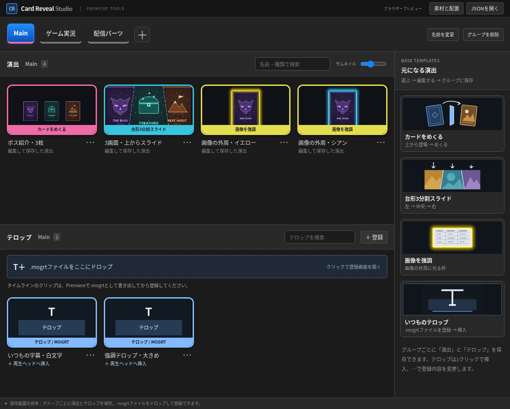
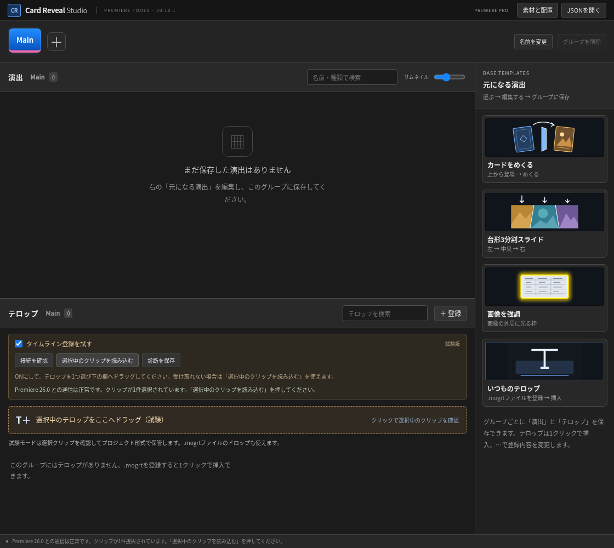
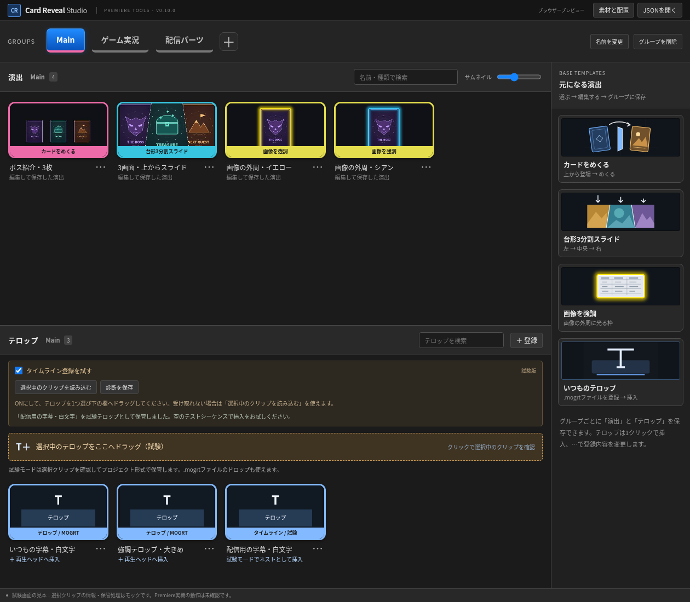
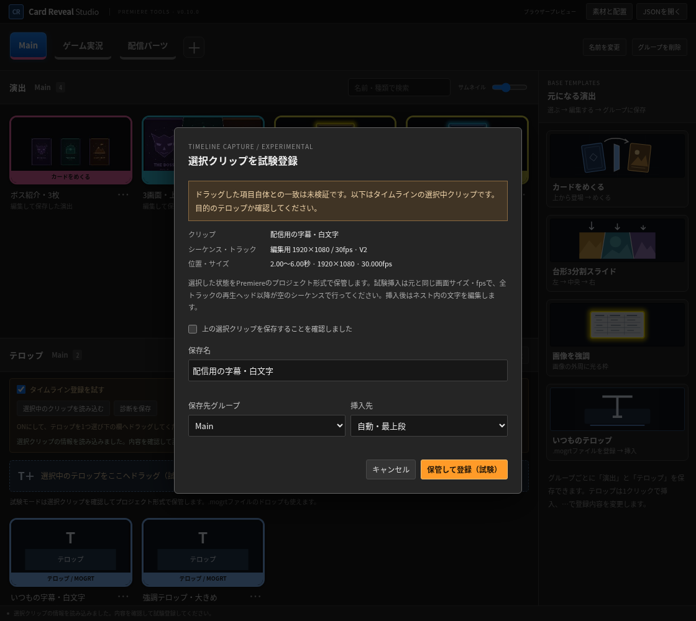
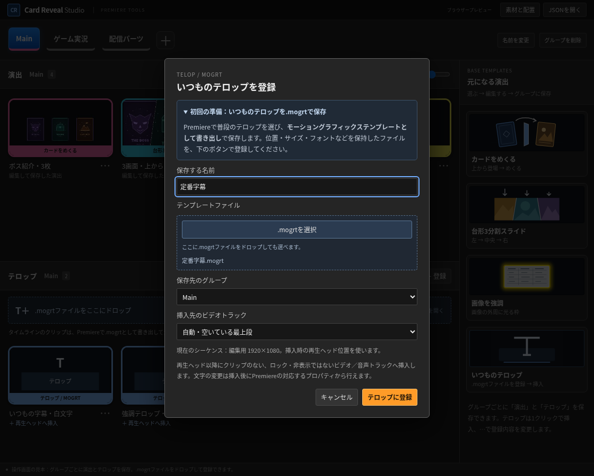
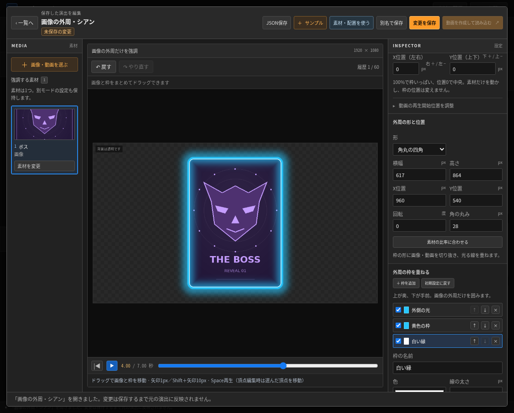

# Card Reveal Studio v0.10.1（通信・選択読み込みの修正版）

Premiere Pro 2026（26.x）・Windows向けの開発版です。カードめくり、台形3分割、画像の外周強調を編集して保存できます。いつものテロップの位置・大きさ・フォントは、.mogrtで登録して1クリックで挿入できます。

## ダウンロードと導入

1. [導入用ZIPをダウンロード](https://github.com/SuGiYaMaKaZuK/-/raw/refs/heads/main/CardReveal-v0.10.1.zip)します。
2. Premiere Proを終了し、ZIPを右クリックして **すべて展開** します。
3. 展開したフォルダーの **Install.cmd** を実行します。管理者権限は不要です。
4. 初回は描画用FFmpegを取得します（約30MB）。完了後にPremiereを起動します。
5. **ウィンドウ → エクステンション → Card Reveal カード演出** を開きます。

更新も同じ手順です。導入用ZIPには本体とサンプル画像が入っています。GitHubの **Code → Download ZIP** から取得した場合も、サンプル画像はインストール時に復元されます。古いZIPを開き直す必要はありません。

## グループ・演出・テロップ

- **上のグループ名：** Mainや自分で作成したグループを切り替えます。＋で追加し、名前の変更や削除もできます。
- **上段の「演出」：** 選択中のグループに保存した、編集済みのカードめくり・台形・外周強調を表示します。クリックで編集します。
- **下段の「テロップ」：** 同じグループに保存したテロップを表示します。クリックで再生ヘッド位置へ挿入、⋯で登録設定を変更します。演出とは別の検索欄と件数表示です。
- **右の「元になる演出」：** 3種類の元データから新しい演出を作れます。「いつものテロップ」からはテンプレートを登録できます。
- **上部の「素材と配置」：** 以前のSABUの画像・動画と大きさ・X/Yを開きます。全グループ共通です。

以前のMAINに混在していた演出とテロップは、それぞれの欄に分けて表示します。保存済みデータや.mogrtの保管コピーは移動・削除しません。画像は実際のパネルにサンプルを保存した見本です。テロップのファイル処理とホスト通信はモックを用いています。

## ドラッグも読み込みボタンも進まない場合（v0.10.1）

「選択中のクリップを読み込む」の開始・失敗を画面に表示し、応答がない場合は10秒で待機を終了します。遅れて届いた古い応答で登録画面を開くことはありません。選択読み込みは同梱スクリプトを直接送信する方式へ変更し、ExtendScript側でファイルを再検索する処理を省きました。

1. Premiereを終了し、新しいZIPをすべて展開して **Install.cmd** で更新します。再起動後、パネル上部が **v0.10.1** になっていることを確認してください。
2. テロップ欄の **接続を確認** を押します。試験モードがOFFでも使えます。
3. **通信は正常** と出た場合は、タイムラインでテロップのビデオクリップを1つ選択し、試験モードをONにして **選択中のクリップを読み込む** を押します。
4. 進まなければ、試験欄に出た文章・エラーコードを控えるか、**診断を保存** でJSONを端末に保存してください。診断を自動送信することはありません。

- `CEP_TIMEOUT`：Premiereから10秒以内に返事が届いていません。Premiere側のダイアログを閉じてから再度確認してください。
- `CEP_UNAVAILABLE`：この画面からPremiereへの接続を検出できません。Premiereのエクステンションとして開いているか確認してください。
- `CEP_SCRIPT_MISSING`：選択読み込み用ファイルが見つからないか、読み取れません。ZIPをすべて展開し、Install.cmdで更新してください。
- `CEP_SCRIPT_ERROR`／`CEP_EMPTY_RESPONSE`／`CEP_INVALID_RESPONSE`／`CEP_DISPATCH_ERROR`：実行失敗・空または不正な応答・通信開始失敗を区別して表示します。
- Node.jsや拡張フォルダーの初期化に失敗した場合も画面に理由を表示します。接続確認はこれらのファイル機能と独立しています。

画面・通信処理・同梱の選択スクリプトを通して、応答の途絶・遅延・各種エラーと操作復帰を検証しました。PremiereのネイティブAPIは模擬しています。**今回の利用環境で動かない原因はまだ特定できておらず、WindowsのPremiere実機では未検証です。** ドラッグしたクリップ自体の自動識別は引き続き行いません。

## タイムラインからの登録を試す（v0.10.0）

**これは実機検証用の試作です。WindowsのPremiereで、ドラッグの受信・見た目の保持・再挿入はまだ確認できていません。** 通常の.mogrt登録は引き続き使えます。

1. **テロップ → タイムライン登録を試す** をONにします。起動・再読み込み時はOFFに戻ります。
2. Premiereのタイムラインで、テロップのビデオクリップを **1つだけ選択** し、下段の試験ドロップ欄へドラッグします。反応しない場合は **選択中のクリップを読み込む** を押してください。
3. 表示された **クリップ名・シーケンス・トラック・時刻・画面サイズ** を確認します。目的のクリップであればチェックを入れ、名前と保存先を決めて **保管して登録（試験）** を押します。
4. 同じ画面サイズ・fpsの **空のテストシーケンス** を開き、試験テロップのサムネイルから再挿入を試します。試験モードはONにしてください。
5. 見た目と文字を確認します。挿入はシーケンス（ネスト）として行い、文字はネストを開いて編集します。無音の音声クリップが追加された場合は画面で案内します。

**この試作が確認する対象は、タイムラインの「選択中クリップ」です。ドラッグした項目自体をデータから識別できたわけではありません。** ドロップをきっかけに選択を読み、保存前に利用者が対象を確認する方式です。ドラッグイベントそのものがPremiereから届かない場合は、ボタンでの読み込みが必要になります。

保存は.mogrtへの変換ではなく、一時シーケンスを複製して選択したクリップだけの `.prproj` を書き出す試作です。フォントや位置をスクリプトから個別に読み直したり書き換えたりせず、Premiereの状態ごと保管する方法を試します。元のシーケンスのクリップとIn/Outは書き換えず、一時シーケンスを後片付けします。作成・削除によってプロジェクトの変更済み表示や履歴が残る場合があり、プロジェクトの保存は自動で実行しません。

### 試験版の制限と保存先

- キャプション・音声・調整レイヤー・ネスト全体は対象外です。キャプションは先にグラフィックへ変換し、ネスト内では実際のテロップを選んでください。
- 画像やAfter Effects素材を含む場合は、元の依存ファイルも必要です。フォントはPCにインストールされている必要があります。
- 試験挿入は、**全ビデオ／音声トラックで再生ヘッド以降にクリップがなく、ロック・非表示ではない** 場合だけ実行します。通常編集中の映像に直接試さず、空のテストシーケンスを使ってください。
- 取り込みで新しい独立シーケンスを特定できない場合や、保存・配置結果を確認できない場合は停止します。自動再試行しません。再度押す前にPremiereの状態を確認してください。
- 保管先はCEPの `userData/CardRevealStudio/timeline-titles/trial-*/title.prproj` です。登録の削除で保管ファイルや挿入済みシーケンスは消しません。
- ⋯から名前・グループ・挿入先の変更と登録の削除ができます。**v0.9.0以前へ戻す場合は、先に試験テロップの登録を削除してください。** 古い版は.prproj形式の登録を読み込めません。元の.mogrt登録・演出・素材と配置のデータは保持します。

### 反応しない・エラーになる場合

**診断を保存** から、端末にJSONを保存できます。ドラッグイベントの有無・形式名・ファイル数、選択読み込み／複製／書き出し／挿入の結果や失敗段階を記録します。ドラッグ本文は記録せず、自動送信は行いません。パネルを閉じたり再読み込みしたりする前に保存してください。

実装は[Adobe CEP公式のSequence.clone/createSubsequence/exportAsProject/importSequences等の型定義](https://github.com/Adobe-CEP/Samples/blob/master/PProPanel/jsx/PremierePro.23.0.d.ts)と[公式サンプル](https://github.com/Adobe-CEP/Samples/blob/master/PProPanel/jsx/PPRO/Premiere.jsx)に基づきます。ネイティブなドラッグ受信の制約は[Adobe公式リポジトリの説明](https://github.com/Adobe-CEP/CEP-Resources/issues/306)を参照してください。

## テロップを.mogrtファイルのドラッグで登録

**通常モードでは、編集タイムラインのクリップを直接登録しません。** 上記の試験モードをOFFにした場合、ドロップできるのは、Premiereで書き出したローカルの **.mogrtファイル** です。タイムラインの不明なドラッグ情報を、現在選択中の別のクリップで代用して登録することはありません。[Adobe公式CEPリポジトリの説明](https://github.com/Adobe-CEP/CEP-Resources/issues/306)も参照してください。

**最初の1回：**

1. Premiereで普段のテロップのグラフィッククリップを選び、**モーショングラフィックステンプレートとして書き出し** で.mogrtを保存します。必要に応じてキャプションをグラフィックへ変換してください。
2. 保存先のグループを選び、下段の **テロップ → .mogrtファイルをここにドロップ** に、エクスプローラーからそのファイルをドラッグします。
3. 開いた登録画面で名前・グループ・挿入先トラックを確認し、**テロップに登録** を押します。**＋ 登録 → .mogrtを選択** でも同じ操作ができます。

登録画面のファイル欄にもドロップできます。差し替え時も入力中の名前と保存先を保持します。ファイルの検証・登録内容の確認が終わるまで、ライブラリを自動で変更しません。複数ファイル・画像・動画・URLだけのドロップは登録しません。

**2回目から：** Premiereで挿入先のシーケンスと再生ヘッド位置を決め、**テロップのサムネイルを1クリック** します。位置・サイズ・フォント・色・縁取り・動きなどは元の.mogrtに含まれる設定を使います。文字の変更は挿入後にPremiereの対応するプロパティで行います。

**挿入先：** 「自動」は再生ヘッド以降にクリップがない、ロック・非表示ではない最上段のビデオトラックを使います。V1・V2などの固定指定も保存できます。音声を含むテンプレートにも備え、同じ条件の空き音声トラックも必要です。空きがない場合は、Premiereで空きトラックを追加してください。既存クリップの上書きや自動のトラック追加は行いません。

登録の **⋯** から名前・グループ・挿入先の変更、.mogrtの差し替え・削除ができます。挿入結果を確認できない場合は、再度押す前にタイムラインを確認してください。

- 使用するフォントはPCにインストールされている必要があります。見た目は元テンプレートとシーケンスの解像度・設計にも依存します。
- 最大256MBのローカル.mogrtが対象です。登録時にCEPのユーザーデータ領域（`userData/CardRevealStudio/telop-templates`）へコピーします。
- 元ファイルを移動しても保管コピーから使えます。拡張の更新や登録の削除で、元ファイル・保管コピー・挿入済みクリップは削除しません。
- サムネイルは共通のTアイコンです。フォントやレイアウトそのもののプレビューではありません。

書き出し手順は[Adobe公式ガイド](https://helpx.adobe.com/premiere/desktop/add-text-images/insert-images-and-graphics/export-graphic-as-a-motion-graphics-template.html)を参照してください。挿入には[Adobe CEP公式サンプル](https://github.com/Adobe-CEP/Samples/blob/master/PProPanel/jsx/PPRO/Premiere.jsx)でも使われる `Sequence.importMGT` を使用します。

## 編集した演出を保存

1. 右側の **元になる演出** を選びます。
2. 編集画面の左で画像・動画を選び、右の設定で素材のサイズ・X/Y、動きや枠を調整します。**サンプル** でも試せます。
3. 中央のプレビューを再生し、時間スライダーで確認します。
4. **グループに保存** を押し、演出の名前と保存先を選びます。
5. **保存して一覧へ** を押すと、そのグループの演出にサムネイルが追加されます。

保存した演出を開いた場合は **変更を保存** で即座に更新し、そのまま編集を続けられます。**別名で保存** は元の保存データを保持してコピーを作成します。保存前に一覧へ戻る場合は、**保存して戻る／保存せずに戻る／編集を続ける** から選べます。編集中は名前の近くに未保存の変更・保存済みを表示します。JSON保存は演出への更新と区別して表示します。

サムネイル横の **⋯** から名前やグループを変更し、保存データを削除できます。同じグループの別の演出へ、同名で自動上書きすることはありません。グループを削除すると、その中の演出は別のグループへ移ります。同名がある場合は番号を付けて両方を保持します。

## 素材と配置を保存・再利用する

素材と配置には、素材のファイルの場所と、**素材の大きさ（%）・X/Y** を保存します。演出の動き、めくる時刻、枠の形・色・レイヤーは保存しません。

**新しい素材を保存する場合：**

1. 上部の **素材と配置 → ＋ 素材を追加** を押します。
2. **画像・動画を選ぶ** で素材を選び、スライダーで大きさを変え、プレビューをドラッグして位置を調整します。数値入力も使えます。
3. 名前を付けて **素材と配置に保存** を押します。

**編集中の素材と配置を保存する場合：**

1. 編集画面で保存したい素材を選択します。
2. **素材・配置を使う → 選択中の素材と配置を保存** を押します。
3. 名前や配置を確認して保存します。

**別の演出で使う場合：**

1. 読み込み先の演出を開き、差し替える素材を選びます。
2. **素材・配置を使う** を押して、保存した素材のサムネイルを選びます。
3. 選択中の素材に画像・動画と大きさ・X/Yが適用されます。ほかの素材、動き、枠は保持されます。

100%は読み込み先の枠を覆う大きさ、X/Yの0は中央です。出力サイズが違う場合、X/Yは同じ相対位置になるよう換算します。カード全体の配置や枠のサイズは、読み込み先の演出で調整してください。

素材と配置のプレビューは矢印キーで1px、Shift＋矢印キーで10px動かせます。**位置だけ中央へ** は大きさを保って位置だけ戻します。

素材と配置を保存せずに閉じる場合は、**保存して戻る／保存せずに戻る／編集を続ける** を選べます。閉じるボタンとEscapeの両方に対応し、保存内容が不正な場合や容量不足の場合は編集中の内容を保持します。別画面で更新された素材と配置素材は、自動で上書きせずメッセージを表示します。

素材と配置のサムネイルから素材と配置を再編集・削除できます。削除しても演出に保存した演出の設定は保持されます。素材と配置は元の画像・動画ファイルを複製する機能ではありません。元の素材ファイルの場所を保持して使います。

## 試した設定を元に戻す・細かく配置する

演出の編集中は、プレビュー上の **↶ 戻す／↷ やり直す** から、設定・素材の差し替え・配置・枠やレイヤーの調整を最大60操作まで戻せます。ドラッグ中の細かな移動や、連続したスライダー調整はまとめて1回として扱います。保存済みの演出も、保存後に編集画面を開いたまま取り消せます。ライブラリへ反映するには、改めて **変更を保存** を押します。

- **Ctrl＋Z：** 元に戻す。**Ctrl＋Shift＋Z／Ctrl＋Y：** やり直す。入力欄にフォーカスがある場合は、入力文字の通常の取り消しを使います。演出全体を戻すときはボタンかプレビューを使ってください。
- プレビューをクリックして選択し、**矢印キーで1px、Shift＋矢印キーで10px** 動かせます。プレビューの縮小率によらず、出力画面のピクセル数で調整します。
- カードでは選択中のカード全体、外周強調では画像と枠、台形では選択中の面の素材を動かします。頂点編集時は選択中の頂点を動かせます。
- カードと強調枠は、**Shiftを押しながらドラッグ** すると横か縦の1方向に動かせます。
- **Space：** プレビューの再生・一時停止。入力中や別のダイアログを操作している間は、その操作を優先します。
- 素材設定の **位置だけ中央** は、大きさを保持して素材のX/Yだけを戻します。**標準に戻す** は大きさも100%へ戻します。

履歴は現在開いている演出の編集用です。ほかの演出・サンプル・JSONを開くと新しい履歴になります。演出・素材と配置の保存項目の登録／削除やPremiereのタイムライン挿入は、ここで戻す対象には含みません。

## 少ない操作で使う

- 演出の検索欄は、選択中のグループ内の名前・演出の種類から検索します。グループを切り替えると検索を解除します。
- 素材と配置は保存名・素材名・画像／動画で検索できます。読み込み画面にも検索欄があります。検索欄でEscapeを押すと検索を解除します。
- 保存済みの演出は、**変更を保存** の1クリックで更新し、編集を続けられます。新規と別名保存では名前・保存先を選びます。候補名には重複しない番号を付けます。
- パネル内にフォーカスがあるとき、編集画面の **Ctrl＋S** は保存、**Ctrl＋Shift＋S** は別名で保存です。素材と配置編集・テロップの登録設定でもCtrl＋Sで保存できます。一覧の **Ctrl＋F** は演出の検索欄へ移動します。

## 3つの元になる演出

### カードをめくる

1〜12枚のカードを上から登場させ、好きな順番・時刻でめくります。カードごとに画像・動画を指定し、プレビューでドラッグして配置できます。横一列・グリッドへの整列、順番の入れ替え、まとめてタイミングを設定する操作も使えます。

### 台形3分割スライド

左・中央・右の3つの素材を上から登場させます。境界の傾き、境界線の色・太さ、登場の速さ・間隔・開始時刻を調整できます。

### 画像を強調

画像・動画全体の外周に枠や光を重ねます。新しく素材を選ぶと縦横比を読み取り、画像全体に合う枠の大きさに自動で合わせます。保存した演出を開く場合は、手動で調整した幅・高さを保持します。

四角・角丸・手動の多角形、位置・サイズ・回転を調整できます。枠のレイヤーは最大12枚で、それぞれ色・太さ・光の広がり・不透明度・外周からの距離を変更できます。自由形状の頂点は3〜12個です。形は手動で合わせる方式です。

素材と配置から素材を適用するときは、読み込み先の枠の形やサイズを保持します。必要に応じて **素材の比率に合わせる** で枠を合わせられます。

## 動画にしてPremiereで使う

編集画面の **動画を作成して読み込む** で、ProRes 4444のMOVを書き出してPremiereのプロジェクトへ読み込みます。完成したMOVをプロジェクトパネルからタイムラインへドラッグして使います。背景透過・単色背景と、24・25・30・60・90・120fpsに対応しています。

動画内の音声は出力しません。変更するときはパネルで設定を編集し、再書き出しします。カードやレイヤーをタイムラインで個別編集する形式ではありません。After Effectsは不要です。

## 保存について

グループ、演出の演出とテロップ登録、素材と配置の素材と配置は、同じPCのパネル内に保存します。旧プリセットはMainに移行し、旧データはバックアップとして保持します。保存データの破損や容量不足で読み込み・保存に失敗しても、既存データへ空のライブラリを上書きしません。

**JSON保存／JSONを開く** は、演出1件の設定の保存と読み込みです。グループ構成・素材と配置一覧・テロップ登録や.mogrtをまとめて保存する形式ではありません。ブラウザー上で選んだローカル素材のファイルの場所は保存できないため、素材の再利用はPremiere内のパネルで確認してください。

演出のサムネイルは保存時のプレビューから作ります。素材の形式や実行環境によって取得できない場合は、設定を示す見本画像を使って保存します。

## 導入と確認状況

導入先は `%APPDATA%\Adobe\CEP\extensions\com.cardreveal.panel` です。インストーラーは、未署名のローカル開発版を表示するため `HKCU\Software\Adobe\CSXS.12` の文字列 `PlayerDebugMode` を `1` にします。他の未署名CEP拡張にも適用される共有設定です。

FFmpegは同梱せず、[固定リリースb6.1.1](https://github.com/eugeneware/ffmpeg-static/releases/tag/b6.1.1)から取得してSHA-256を照合します。取得できない場合は[FFmpeg公式案内](https://ffmpeg.org/download.html)のWindowsビルドの `ffmpeg.exe` を、インストール先の `bin` に配置してください。PATH上のFFmpegも利用できます。

削除するときはPremiereを終了し、`uninstall-windows.ps1` を実行します。元の素材・出力MOVと共有の開発用レジストリ設定は保持します。

検証内容は `検証結果.txt` を参照してください。**WindowsインストーラーとPremiere Pro 2026実機内の動作は未検証です。** Adobe Marketplaceの署名済み製品ではありません。

開発用の確認はNode.js 18以降・FFmpeg・ffprobeで `npm test`、Playwright・Chromiumを用意して `node tests/ui-smoke.cjs`、`node tests/titles-ui-smoke.cjs`、`node tests/editing-ui-smoke.cjs`、`node tests/telop-layout-ui-smoke.cjs`、`node tests/timeline-trial-ui-smoke.cjs`、`node tests/connection-ui-smoke.cjs` を実行します。パネル本体へのnpmパッケージ導入は不要です。

## v0.6.0の変更

上部のグループ名、中央のMAIN（編集済み演出）、MAIN直下のSABU（素材と大きさ・X/Y）、右の元になる演出へ画面を整理しました。グループ追加・名前変更、演出の移動・再編集・別名保存、旧プリセットの引き継ぎに対応しています。

## v0.6.1の変更

MAIN・SABUの検索、ワンクリック更新、保存状態の表示、保存して戻る操作、保存ショートカットを追加しました。SABUはドラッグ・矢印キー・サイズスライダーで調整できます。ほかの画面で更新された演出は、現在のドラフトで自動上書きしません。

## v0.7.0の変更

いつものテロップを.mogrtとして登録し、MAINのサムネイルから再生ヘッド位置へ挿入できます。テンプレートの位置・サイズ・フォントなどを保持し、更新時に消えない場所へ複製して保管します。グループ・検索・登録設定・空きトラックの選択・二重挿入防止に対応しました。

## v0.8.0の変更

演出編集に60操作の元に戻す／やり直すを追加しました。連続入力をまとめ、差し替え前の素材も履歴の範囲内で再表示できます。プレビューの矢印キー移動・Space再生・Shiftドラッグ、素材の大きさを保った中央戻しに対応しました。SABUには未保存で閉じる際の3択と、別画面の更新を上書きしない処理を追加しています。

## v0.9.0の変更

各グループの上段を「演出」、下段を「テロップ」に分け、別々の検索・件数表示にしました。旧SABUは上部の「素材と配置」へ移しています。テロップは.mogrtファイルを専用欄や登録画面へドラッグして選べます。タイムラインのクリップを直接ドラッグして登録する機能は未対応です。

## v0.10.0の変更

タイムライン登録を調べる試験モードを追加しました。ドラッグをきっかけに選択中のビデオクリップを読み、対象を確認してから一時シーケンス経由でプロジェクト形式へ保管します。空のテストシーケンスへのネスト挿入、段階別の失敗処理、ローカル診断JSONに対応しています。ドラッグ項目自体の識別やPremiere実機での見た目の保持を確認した版ではありません。

## v0.10.1の変更

選択読み込みの開始・通信エラー・初期化失敗を画面に表示し、読み取り専用の通信は10秒で待機を終了します。独立した接続確認、選択スクリプトの直接送信、遅い古い応答の無視、診断への環境・通信状態の追加に対応しました。実機の成功確認を伴う修正ではありません。
