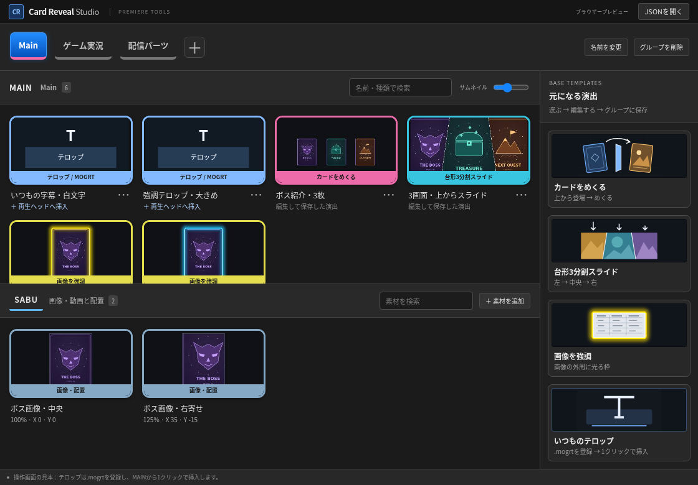
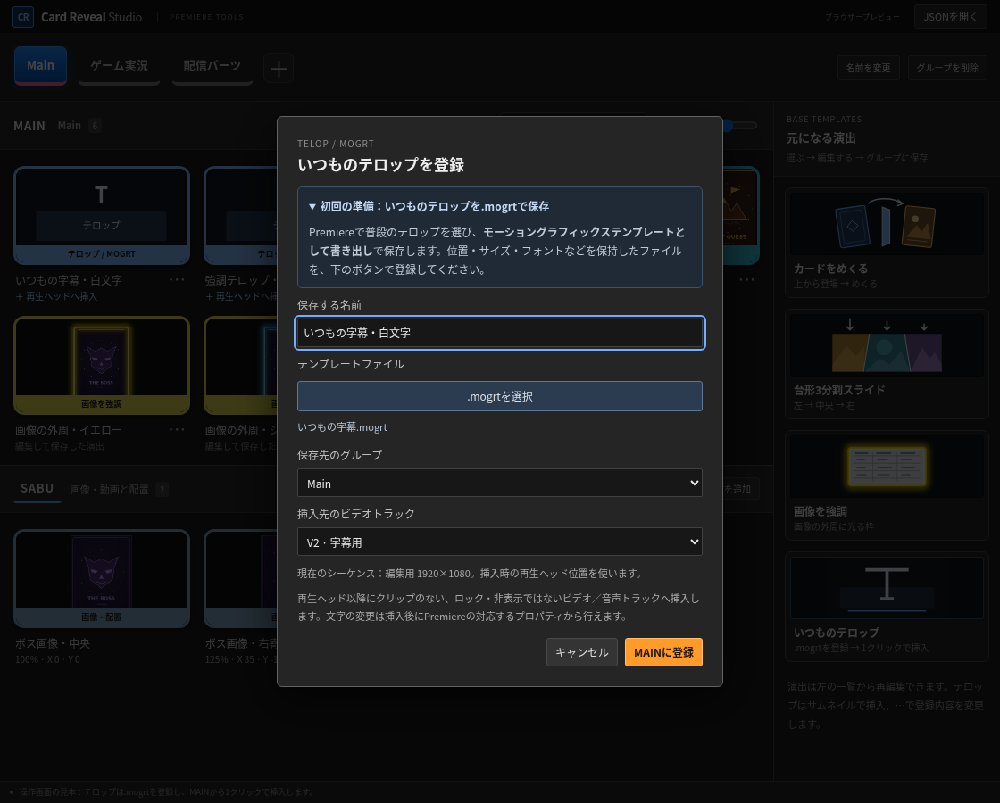
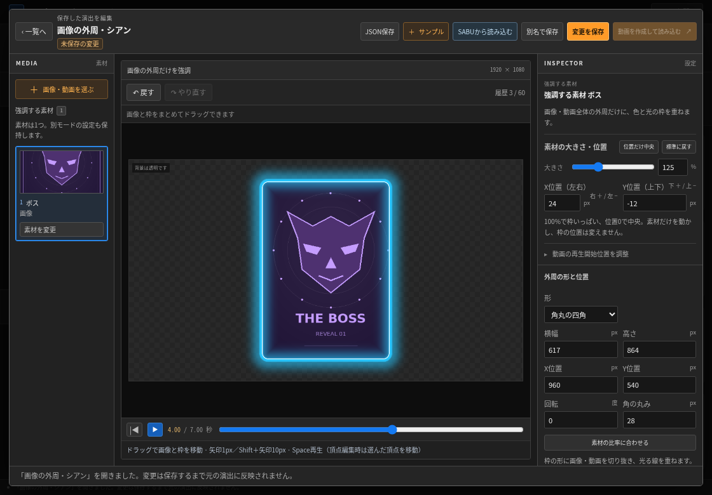
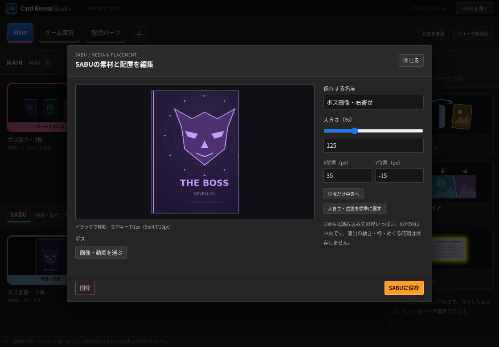
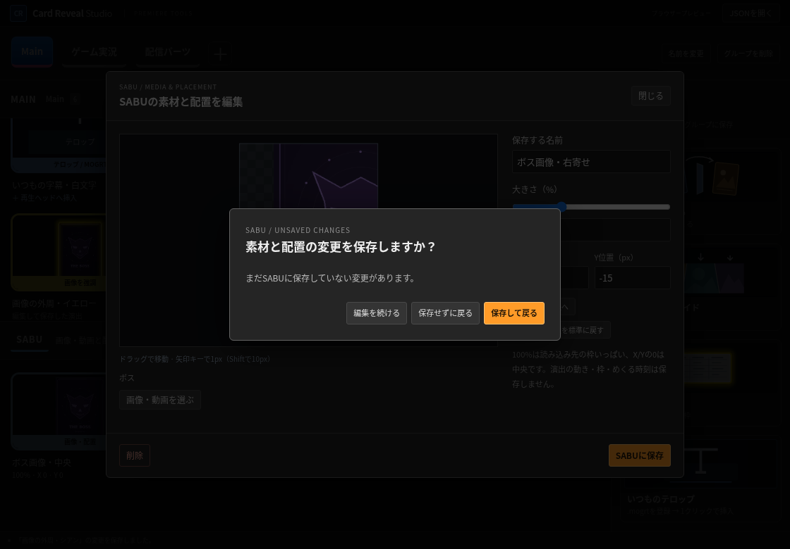

# Card Reveal Studio v0.8.0

Premiere Pro 2026（26.x）・Windows向けの開発版です。カードめくり、台形3分割、画像の外周強調を編集して保存できます。いつものテロップの位置・大きさ・フォントは、.mogrtで登録して1クリックで挿入できます。

## ダウンロードと導入

1. [導入用ZIPをダウンロード](https://github.com/SuGiYaMaKaZuK/-/raw/refs/heads/main/CardReveal-v0.8.0.zip)します。
2. Premiere Proを終了し、ZIPを右クリックして **すべて展開** します。
3. 展開したフォルダーの **Install.cmd** を実行します。管理者権限は不要です。
4. 初回は描画用FFmpegを取得します（約30MB）。完了後にPremiereを起動します。
5. **ウィンドウ → エクステンション → Card Reveal カード演出** を開きます。

更新も同じ手順です。導入用ZIPには本体とサンプル画像が入っています。GitHubの **Code → Download ZIP** から取得した場合も、サンプル画像はインストール時に復元されます。古いZIPを開き直す必要はありません。

## グループ・MAIN・SABU

画像はサンプル素材を編集して保存した例です。テロップの登録処理はモックを用いた操作画面の見本で、Premiere実機の挿入結果ではありません。初回は **Main** グループが作成され、以前の保存プリセットがあればMainに引き継ぎます。

- **上のグループ名：** Mainや自分で作成したグループを切り替えます。＋で追加し、名前の変更や削除もできます。
- **中央のMAIN：** 選択中のグループに保存した演出とテロップを表示します。演出はクリックで編集、テロップはクリックでタイムラインへ挿入します。
- **MAINのすぐ下のSABU：** 画像・動画と素材の大きさ・X/Yだけを保存する、全グループ共通の一覧です。MAINとSABUはそれぞれスクロールできます。
- **右の元になる演出：** カードめくり・台形3分割・画像強調の3つの元データです。クリックすると新しい編集画面が開きます。下の **いつものテロップ** から.mogrtも登録できます。

元の演出を編集しても、元データ自体は変わりません。保存した演出は中央のサムネイルから開いて再編集できます。

## いつものテロップを1クリックで挿入

普段のテロップを **モーショングラフィックステンプレート（.mogrt）** にして登録します。文字の位置・サイズ・フォント・色・縁取り・動きなどは、元のテンプレートに含まれる設定をそのまま使います。タイムライン上の既存テロップから、パネルが直接フォントや位置を自動抽出する方式ではありません。

**最初の1回：**

1. Premiereで普段のテロップのグラフィッククリップを選び、**モーショングラフィックステンプレートとして書き出し** でローカルに.mogrtを保存します。キャプションは、必要に応じてPremiereでグラフィックへ変換してください。
2. このパネルの右側にある **いつものテロップ → .mogrtを選択** を押します。
3. 保存名・グループ・ビデオトラックを選び、**MAINに登録** を押します。シーケンスを開く前でも登録できます。

**2回目から：**

1. Premiereで挿入先のシーケンスを開き、再生ヘッドを入れたい位置に置きます。
2. MAINのテロップのサムネイルを1クリックすると、その位置へ挿入します。
3. 挿入したクリップの文字は、Premiereの対応するプロパティで変更します。テンプレートが公開していない項目は編集できない場合があります。

**挿入先：** 「自動」は再生ヘッド以降にクリップがない、ロック・非表示ではない最上段のビデオトラックを使います。V1・V2などの固定指定も保存できます。音声を含むテンプレートにも備え、同じ条件の空き音声トラックを必要とします。空きがない場合は挿入を止めるので、Premiereで空きのビデオ／音声トラックを追加してください。既存クリップを上書きする操作や、自動のトラック追加は行いません。

登録の **⋯** から、名前・グループ・挿入先を変更したり、別の.mogrtに差し替えたりできます。連打中・処理中の二重挿入を防ぎます。挿入を確認できない場合はメッセージを表示するため、再度押す前にタイムラインを確認してください。

- 使用したフォントは、このPCにもインストールされている必要があります。フォントファイル自体を同梱・複製する機能ではありません。
- 位置・見た目はテンプレートとシーケンスの解像度・設計にも左右されるため、普段と同じシーケンス設定で確認してください。
- .mogrtは登録時にCEPのユーザーデータ領域（`userData/CardRevealStudio/telop-templates`）へコピーします。元の.mogrtを移動しても、そのコピーから再利用します。登録の削除や拡張の更新では、元ファイル・保管コピー・挿入済みクリップを削除しません。
- 最大256MBのローカル.mogrtが対象です。クラウドライブラリの項目は、先にローカルへ書き出してください。
- テロップのサムネイルは共通のTアイコンです。実際のフォントやレイアウトのプレビューではありません。

書き出し手順は[Adobe公式ガイド](https://helpx.adobe.com/premiere/desktop/add-text-images/insert-images-and-graphics/export-graphic-as-a-motion-graphics-template.html)を参照してください。挿入には[Adobe CEP公式サンプル](https://github.com/Adobe-CEP/Samples/blob/master/PProPanel/jsx/PPRO/Premiere.jsx)でも使われる `Sequence.importMGT` を使用します。

## 演出を編集してMAINに保存

1. 右側の **元になる演出** を選びます。
2. 編集画面の左で画像・動画を選び、右の設定で素材のサイズ・X/Y、動きや枠を調整します。**サンプル** でも試せます。
3. 中央のプレビューを再生し、時間スライダーで確認します。
4. **グループに保存** を押し、演出の名前と保存先を選びます。
5. **保存して一覧へ** を押すと、そのグループのMAINにサムネイルが追加されます。

保存した演出を開いた場合は **変更を保存** で即座に更新し、そのまま編集を続けられます。**別名で保存** は元の保存データを保持してコピーを作成します。保存前に一覧へ戻る場合は、**保存して戻る／保存せずに戻る／編集を続ける** から選べます。編集中は名前の近くに未保存の変更・保存済みを表示します。JSON保存はMAINへの更新と区別して表示します。

サムネイル横の **⋯** から名前やグループを変更し、保存データを削除できます。同じグループの別の演出へ、同名で自動上書きすることはありません。グループを削除すると、その中の演出は別のグループへ移ります。同名がある場合は番号を付けて両方を保持します。

## SABUに素材と配置を保存する

SABUには、素材のファイルの場所と、**素材の大きさ（%）・X/Y** を保存します。演出の動き、めくる時刻、枠の形・色・レイヤーは保存しません。

**新しい素材を保存する場合：**

1. MAINの下の **SABU → ＋ 素材を追加** を押します。
2. **画像・動画を選ぶ** で素材を選び、スライダーで大きさを変え、プレビューをドラッグして位置を調整します。数値入力も使えます。
3. 名前を付けて **SABUに保存** を押します。

**編集中の素材と配置を保存する場合：**

1. 編集画面で保存したい素材を選択します。
2. **SABUから読み込む → 選択中の素材と配置をSABUに保存** を押します。
3. 名前や配置を確認して保存します。

**別の演出で使う場合：**

1. 読み込み先の演出を開き、差し替える素材を選びます。
2. **SABUから読み込む** を押して、保存した素材のサムネイルを選びます。
3. 選択中の素材に画像・動画と大きさ・X/Yが適用されます。ほかの素材、動き、枠は保持されます。

100%は読み込み先の枠を覆う大きさ、X/Yの0は中央です。出力サイズが違う場合、X/Yは同じ相対位置になるよう換算します。カード全体の配置や枠のサイズは、読み込み先の演出で調整してください。

SABUのプレビューは矢印キーで1px、Shift＋矢印キーで10px動かせます。**位置だけ中央へ** は大きさを保って位置だけ戻します。

SABUを保存せずに閉じる場合は、**保存して戻る／保存せずに戻る／編集を続ける** を選べます。閉じるボタンとEscapeの両方に対応し、保存内容が不正な場合や容量不足の場合は編集中の内容を保持します。別画面で更新されたSABU素材は、自動で上書きせずメッセージを表示します。

SABUのサムネイルから素材と配置を再編集・削除できます。削除してもMAINに保存した演出の設定は保持されます。SABUは元の画像・動画ファイルを複製する機能ではありません。元の素材ファイルの場所を保持して使います。

## 試した設定を元に戻す・細かく配置する

演出の編集中は、プレビュー上の **↶ 戻す／↷ やり直す** から、設定・素材の差し替え・配置・枠やレイヤーの調整を最大60操作まで戻せます。ドラッグ中の細かな移動や、連続したスライダー調整はまとめて1回として扱います。保存済みの演出も、保存後に編集画面を開いたまま取り消せます。ライブラリへ反映するには、改めて **変更を保存** を押します。

- **Ctrl＋Z：** 元に戻す。**Ctrl＋Shift＋Z／Ctrl＋Y：** やり直す。入力欄にフォーカスがある場合は、入力文字の通常の取り消しを使います。演出全体を戻すときはボタンかプレビューを使ってください。
- プレビューをクリックして選択し、**矢印キーで1px、Shift＋矢印キーで10px** 動かせます。プレビューの縮小率によらず、出力画面のピクセル数で調整します。
- カードでは選択中のカード全体、外周強調では画像と枠、台形では選択中の面の素材を動かします。頂点編集時は選択中の頂点を動かせます。
- カードと強調枠は、**Shiftを押しながらドラッグ** すると横か縦の1方向に動かせます。
- **Space：** プレビューの再生・一時停止。入力中や別のダイアログを操作している間は、その操作を優先します。
- 素材設定の **位置だけ中央** は、大きさを保持して素材のX/Yだけを戻します。**標準に戻す** は大きさも100%へ戻します。

履歴は現在開いている演出の編集用です。ほかの演出・サンプル・JSONを開くと新しい履歴になります。MAIN・SABUの保存項目の登録／削除やPremiereのタイムライン挿入は、ここで戻す対象には含みません。

## 少ない操作で使う

- MAINの検索欄は、選択中のグループ内の名前・演出の種類から検索します。グループを切り替えると検索を解除します。
- SABUは保存名・素材名・画像／動画で検索できます。読み込み画面にも検索欄があります。検索欄でEscapeを押すと検索を解除します。
- 保存済みの演出は、**変更を保存** の1クリックで更新し、編集を続けられます。新規と別名保存では名前・保存先を選びます。候補名には重複しない番号を付けます。
- パネル内にフォーカスがあるとき、編集画面の **Ctrl＋S** は保存、**Ctrl＋Shift＋S** は別名で保存です。SABU編集・テロップの登録設定でもCtrl＋Sで保存できます。一覧の **Ctrl＋F** はMAINの検索欄へ移動します。

## 3つの元になる演出

### カードをめくる

1〜12枚のカードを上から登場させ、好きな順番・時刻でめくります。カードごとに画像・動画を指定し、プレビューでドラッグして配置できます。横一列・グリッドへの整列、順番の入れ替え、まとめてタイミングを設定する操作も使えます。

### 台形3分割スライド

左・中央・右の3つの素材を上から登場させます。境界の傾き、境界線の色・太さ、登場の速さ・間隔・開始時刻を調整できます。

### 画像を強調

画像・動画全体の外周に枠や光を重ねます。新しく素材を選ぶと縦横比を読み取り、画像全体に合う枠の大きさに自動で合わせます。保存した演出を開く場合は、手動で調整した幅・高さを保持します。

四角・角丸・手動の多角形、位置・サイズ・回転を調整できます。枠のレイヤーは最大12枚で、それぞれ色・太さ・光の広がり・不透明度・外周からの距離を変更できます。自由形状の頂点は3〜12個です。形は手動で合わせる方式です。

SABUから素材を適用するときは、読み込み先の枠の形やサイズを保持します。必要に応じて **素材の比率に合わせる** で枠を合わせられます。

## 動画にしてPremiereで使う

編集画面の **動画を作成して読み込む** で、ProRes 4444のMOVを書き出してPremiereのプロジェクトへ読み込みます。完成したMOVをプロジェクトパネルからタイムラインへドラッグして使います。背景透過・単色背景と、24・25・30・60・90・120fpsに対応しています。

動画内の音声は出力しません。変更するときはパネルで設定を編集し、再書き出しします。カードやレイヤーをタイムラインで個別編集する形式ではありません。After Effectsは不要です。

## 保存について

グループ、MAINの演出とテロップ登録、SABUの素材と配置は、同じPCのパネル内に保存します。旧プリセットはMainに移行し、旧データはバックアップとして保持します。保存データの破損や容量不足で読み込み・保存に失敗しても、既存データへ空のライブラリを上書きしません。

**JSON保存／JSONを開く** は、演出1件の設定の保存と読み込みです。グループ構成・SABU一覧・テロップ登録や.mogrtをまとめて保存する形式ではありません。ブラウザー上で選んだローカル素材のファイルの場所は保存できないため、素材の再利用はPremiere内のパネルで確認してください。

演出のサムネイルは保存時のプレビューから作ります。素材の形式や実行環境によって取得できない場合は、設定を示す見本画像を使って保存します。

## 導入と確認状況

導入先は `%APPDATA%\Adobe\CEP\extensions\com.cardreveal.panel` です。インストーラーは、未署名のローカル開発版を表示するため `HKCU\Software\Adobe\CSXS.12` の文字列 `PlayerDebugMode` を `1` にします。他の未署名CEP拡張にも適用される共有設定です。

FFmpegは同梱せず、[固定リリースb6.1.1](https://github.com/eugeneware/ffmpeg-static/releases/tag/b6.1.1)から取得してSHA-256を照合します。取得できない場合は[FFmpeg公式案内](https://ffmpeg.org/download.html)のWindowsビルドの `ffmpeg.exe` を、インストール先の `bin` に配置してください。PATH上のFFmpegも利用できます。

削除するときはPremiereを終了し、`uninstall-windows.ps1` を実行します。元の素材・出力MOVと共有の開発用レジストリ設定は保持します。

検証内容は `検証結果.txt` を参照してください。**WindowsインストーラーとPremiere Pro 2026実機内の動作は未検証です。** Adobe Marketplaceの署名済み製品ではありません。

開発用の確認はNode.js 18以降・FFmpeg・ffprobeで `npm test`、Playwright・Chromiumを用意して `node tests/ui-smoke.cjs`、`node tests/titles-ui-smoke.cjs`、`node tests/editing-ui-smoke.cjs` を実行します。パネル本体へのnpmパッケージ導入は不要です。

## v0.6.0の変更

上部のグループ名、中央のMAIN（編集済み演出）、MAIN直下のSABU（素材と大きさ・X/Y）、右の元になる演出へ画面を整理しました。グループ追加・名前変更、演出の移動・再編集・別名保存、旧プリセットの引き継ぎに対応しています。

## v0.6.1の変更

MAIN・SABUの検索、ワンクリック更新、保存状態の表示、保存して戻る操作、保存ショートカットを追加しました。SABUはドラッグ・矢印キー・サイズスライダーで調整できます。ほかの画面で更新された演出は、現在のドラフトで自動上書きしません。

## v0.7.0の変更

いつものテロップを.mogrtとして登録し、MAINのサムネイルから再生ヘッド位置へ挿入できます。テンプレートの位置・サイズ・フォントなどを保持し、更新時に消えない場所へ複製して保管します。グループ・検索・登録設定・空きトラックの選択・二重挿入防止に対応しました。

## v0.8.0の変更

演出編集に60操作の元に戻す／やり直すを追加しました。連続入力をまとめ、差し替え前の素材も履歴の範囲内で再表示できます。プレビューの矢印キー移動・Space再生・Shiftドラッグ、素材の大きさを保った中央戻しに対応しました。SABUには未保存で閉じる際の3択と、別画面の更新を上書きしない処理を追加しています。
